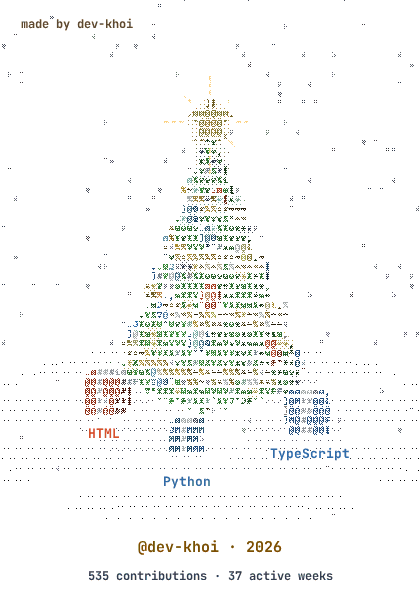

# Merry Gitmas

Turn your GitHub activity into a rotating ASCII Christmas tree, with language-colored gifts, weekly lights, falling snow, and a glowing star.

<picture>
  <source media="(prefers-color-scheme: dark)" srcset="gitmas/tree.gif" />
  <source media="(prefers-color-scheme: light)" srcset="gitmas/tree-light.gif" />
  
</picture>

## How to set up your own GITMAS tree

Set this up once in your **profile repository**: the repository named exactly your GitHub username, such as `dev-khoi/dev-khoi`.

1. Copy [`examples/profile-workflow.yml`](examples/profile-workflow.yml) into that repository as `.github/workflows/gitmas.yml`.
2. Commit it to the default branch. The workflow runs immediately and then every night.
3. Add this to your profile `README.md`:

   ```html
   <picture>
     <source media="(prefers-color-scheme: dark)" srcset="gitmas/tree.gif" />
     <source media="(prefers-color-scheme: light)" srcset="gitmas/tree-light.gif" />
     
   </picture>
   ```

The image switches automatically with the viewer's theme. If you already use an older workflow, update its commit step to include `tree-light.gif` and `tree-light.png` as shown in the example.

## What shapes the tree?

| Your activity | What you see |
| --- | --- |
| Total contributions in the selected year | A larger, fuller tree, with a capped maximum size |
| Weeks with contributions | Mint spiral lights |
| Your longest streak of active weeks | Gold spiral lights |
| Contributions in the last seven observed days | A stronger, pulsing star aura |
| Top six languages in public, non-fork repositories | Matching ornament colors, gifts, and language labels |
| Number of selected languages | Fewer gifts rotate faster |

- Contributions include the activity GitHub exposes to the workflow token, not just commits. Language shares count repositories by their primary language. The current year includes completed days through yesterday UTC.

- GIF and PNG backgrounds are transparent. 

- It offers Dark-mode artwork keeps its bright glow; light-mode artwork uses deeper colors, darker text, and subtler glow and ground effects. The offline HTML preview follows your browser's light or dark theme.

## Files and advanced options

- `tree.gif` / `tree.png` — dark-mode animation and still image.
- `tree-light.gif` / `tree-light.png` — light-mode animation and still image.
- `preview.html` — interactive preview with pause and scrubbing controls.
- `snapshot.json` — saved GitHub data that can be rendered again without fetching.
- `tree-state.json` — calculated appearance settings.
- `FONT-LICENSE.txt` — bundled font license.

## Documentation

- [Development and customization](docs/development.md) — details how to build/run locally, render saved snapshots, adjust the tree's appearance, configure exports, and understand the GitHub Actions inputs.
- [Renderer extraction](docs/extraction.md) — understand the source renderer, regenerate it, and learn how personalization and transparency are applied.
- [Action reference](action.yml) — see the reusable action's inputs, defaults, and output paths for both light and dark artwork.
