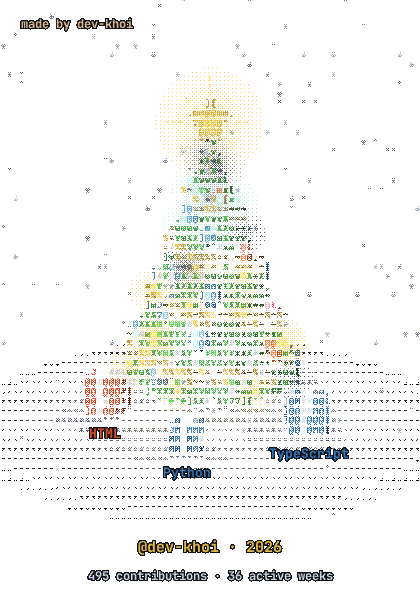

# Merry Gitmas

Turn your GitHub activity into a rotating ASCII Christmas tree, with language-colored gifts, weekly lights, falling snow, and a glowing star.



## How to set up your own GITMAS tree

Set this up once in your **profile repository**: the repository named exactly your GitHub username, such as `dev-khoi/dev-khoi`.

1. Copy [`examples/profile-workflow.yml`](examples/profile-workflow.yml) into that repository as `.github/workflows/gitmas.yml`.
2. Commit it to the default branch. The workflow runs immediately and then every night.
3. Add this to your profile `README.md`:

   ```html
   
   ```

## What shapes the tree?

| Your activity | What you see |
| --- | --- |
| Total contributions in the selected year | A larger, fuller tree, with a capped maximum size |
| Weeks with contributions | Mint spiral lights |
| Your longest streak of active weeks | Gold spiral lights |
| Contributions in the last seven observed days | A stronger, pulsing star aura |
| Top six languages in public, non-fork repositories | Matching ornament colors, gifts, and language labels |
| Number of selected languages | Fewer gifts rotate faster |

Contributions include the activity GitHub exposes to the workflow token, not just commits. Language shares count repositories by their primary language; they are not a measure of coding time. The current year includes completed days through yesterday UTC. You can also choose a past year.

GIF and PNG backgrounds are transparent. GIF glows use fine dithering; PNG preserves smooth transparency. The HTML preview has a dark background and works offline.

## Files and advanced options

- `tree.gif` — animated image for your README.
- `tree.png` — still image.
- `preview.html` — interactive preview with pause and scrubbing controls.
- `snapshot.json` — saved GitHub data that can be rendered again without fetching.
- `tree-state.json` — calculated appearance settings.
- `FONT-LICENSE.txt` — bundled font license.

See [development and customization](docs/development.md) for rendering saved data, action inputs, and appearance controls, or [renderer extraction](docs/extraction.md) for the source-renderer details.
